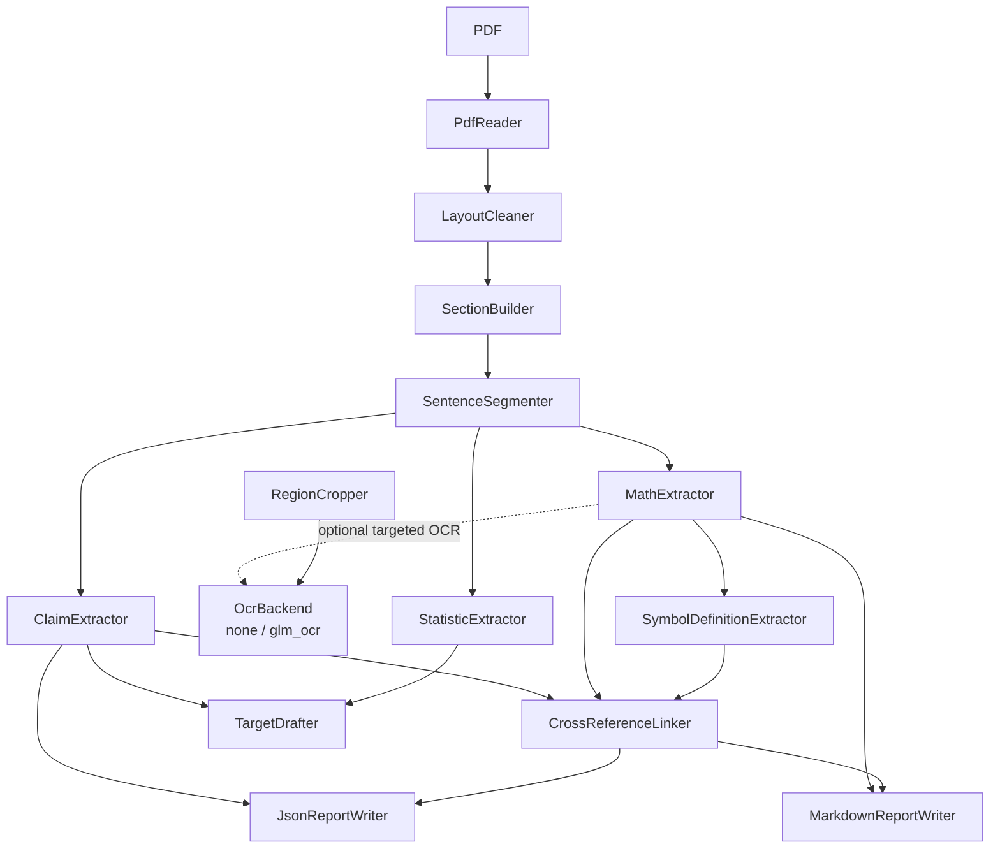

# Architecture

## Package tree

One line per module, all under `src/econ_pdf_extract/`:

| Module | Line |
|---|---|
| `core/config.py` | `ConfigLoader` — loads and validates YAML configs from `references/configs/` |
| `core/models.py` | Full-provenance dataclasses and enums (`Claim`, `MathObject`, `SymbolDef`, `Section`, `ExtractionResult`, ...) |
| `core/paths.py` | `PROJECT_ROOT`, `CONFIGS_DIR`, `load_dictionary()` |
| `layout/reader.py` | `PdfReader` — PyMuPDF ingestion into `Document`/`Page`/`Block`/`Line`/`Span` |
| `layout/cleaners.py` | `LayoutCleaner` — drops headers/footers, margin noise, footnotes, tables, captions; resolves duplicate front matter and printed page numbers |
| `layout/sections.py` | `SectionBuilder` — heading detection, section spans, `SectionRole` classification |
| `layout/sentences.py` | `SentenceSegmenter` — clean sentence segmentation with true page and bbox provenance |
| `claims/extractor.py` | `ClaimExtractor` — orchestrate classify, attribute, dedup, refine into `Claim` objects |
| `claims/classifier.py` | `ClaimClassifier` — YAML-driven 8-category taxonomy with significance collision guards |
| `claims/attribution.py` | `AttributionClassifier` — `own` / `literature` / `comparison` / `unclear` |
| `claims/dedup.py` | `ClaimDeduplicator` — near-duplicate clustering (Union-Find), canonical + `also_seen_on` |
| `claims/refiner.py` | `ClaimRefiner` (ABC) and `NullClaimRefiner` — optional post-extraction hook |
| `math_extract/displays.py` | `DisplayEquationDetector` — tagged and unnumbered display equations, baseline clustering, `needs_ocr` scoring |
| `math_extract/logic.py` | `LogicExtractor` — math-kind classification and prose assumptions/algorithms/propositions/definitions |
| `math_extract/symbols.py` | `SymbolDefinitionExtractor` — "where ... denotes" symbol definitions, `normalize_symbol()` |
| `math_extract/extractor.py` | `MathExtractor` — coordinates display detection, targeted OCR, logic, symbols |
| `linking/linker.py` | `CrossReferenceLinker` — bidirectional `Claim`/`MathObject`/`SymbolDef` edges |
| `ocr/base.py` | `OcrBackend` (ABC), `NullOcrBackend`, `OcrResult`, `OcrMode`, `OcrPolicy` |
| `ocr/glm_ocr.py` | `GlmOcrBackend` — stdlib OpenAI-compatible client for a remote vLLM GLM-OCR server |
| `ocr/factory.py` | `OcrBackendFactory` — resolves `none` / `glm_ocr` backend names |
| `ocr/cropper.py` | `RegionCropper` — pads display bboxes (excludes right-margin tags), renders PNG crops |
| `targets/statistics.py` | `StatisticExtractor` — clean-sentence statistic extraction (coefficients, R-squared, p-values, ...) |
| `targets/drafter.py` | `TargetDrafter` — MaRCo@BIS-style draft target YAML linking claims and statistics |
| `reporting/json_writer.py` | `JsonReportWriter` — full-provenance JSON with literature/duplicate filters |
| `reporting/markdown.py` | `MarkdownReportWriter`, `BatchSummaryWriter` — auditable Markdown tables |
| `pipeline/runner.py` | `ExtractionPipeline` — single-PDF end-to-end orchestration |
| `pipeline/batch.py` | `BatchPipeline` — multi-paper registry runner from `papers.yaml` |
| `eval/evaluator.py` | `ClaimEvaluator` — offline benchmark against local reference claim YAMLs |
| `cli.py` | `Cli` — `extract`, `report`, `targets`, `eval` subcommands (`econ-pdf` entry point) |

## Data flow

`ExtractionPipeline.run()` composes these stages and returns one `ExtractionResult`:

1. **Layout** — `PdfReader` → `LayoutCleaner` → `SectionBuilder` → `SentenceSegmenter`
2. **Claims** — `ClaimExtractor` (classifier + attribution + dedup + optional refiner)
3. **Math & logic** — `MathExtractor` (display detection → logic classification → optional targeted OCR → symbols)
4. **Linking & statistics** — `CrossReferenceLinker`, `StatisticExtractor`
5. **Diagnostics** — sentence/claim/symbol/link counts, OCR calls, scanned-page warnings

## Data model

All models live in `core/models.py` and carry provenance (`page`, `section`, `bbox`, `source_channel`). Every dataclass implements `to_dict()` for JSON serialization.

| Model | Key fields | Provenance |
|---|---|---|
| `Claim` | `claim_id`, `claim_types`, `attribution`, `quote`, `matched_cues`, `math_tokens`, `duplicate_of`, `also_seen_on`, `linked_equation_ids`, `linked_symbols` | `page`, `page_end`, `section`, `section_role`, `bbox`, `printed_page`, `source_channel` |
| `MathObject` | `math_id`, `kind` (`MathKind`), `tag` (e.g. `(3)`), `raw_text`, `latex`, `needs_ocr`, `ocr_reasons`, `symbols_defined`, `context_before`/`context_after`, `linked_claim_ids` | `page`, `page_end`, `section`, `bbox`, `tag_bbox`, `source_channel` |
| `SymbolDef` | `symbol_id`, `symbol`, `normalized`, `description`, `equation_id` | `page`, `section`, `bbox`, `source_channel` |
| `Section` | `section_id`, `heading`, `role` (`SectionRole`), `is_duplicate_front_matter` | `page_start`, `page_end` |
| `ExtractionResult` | `paper`, `claims`, `math_objects`, `symbols`, `links`, `statistics`, `diagnostics` | `page_count`, `ocr_backend`, `ocr_policy`, `extracted_at` |

Supporting models: `Span`, `Line`, `Block`, `Page` (layout), `CrossRefEdge` (`claim_id`, `math_id`, `via`: `explicit_ref` / `symbol` / `named_metric`), `Statistic`, `PaperMetadata`, `ProvenanceRef`.

Key enums: `ClaimType` (8 categories + `general`), `Attribution`, `MathKind` (8 kinds), `SectionRole` (11 roles), `SourceChannel` (`text` / `ocr`), `BlockKind`.

See [usage.md](usage.md) for commands and [claims.md](claims.md) / [math.md](math.md) for extraction semantics.
